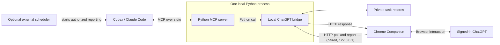

# ask-my-chatgpt

**Let Codex and Claude Code talk to your own signed-in ChatGPT through a Chrome
extension: send project updates, get a second opinion, and keep one conversation
you can come back to.**

> [!IMPORTANT]
> **Unofficial — not affiliated with or endorsed by OpenAI or Anthropic.**
> This project automates the ChatGPT website in your own browser. That may conflict
> with OpenAI's terms of use, and it may trigger rate limits, safeguards or
> restrictions on your account. Use it at your own risk. **Never send passwords,
> API keys, tokens, private keys, `.env` files or personal data** — nothing is
> filtered before it reaches ChatGPT.

> [!NOTE]
> **AI-generated project.** The code was generated by **OpenAI Codex and Claude
> Code** under human direction. It is a practical tool, not a teaching example.
> Read the permissions section before installing, and test the parts you rely on.
> Contributions are welcome.

**Status:** Windows-first developer preview · MIT license ·
[Install](docs/getting-started.md) · [Workflows](docs/workflows.md) ·
[Design](docs/design.md) · [Tests](docs/testing.md) · [Contribute](CONTRIBUTING.md)

---

## Part 1 — What it does

### 1. A ChatGPT bridge for coding agents (main feature)

Your coding agent works inside the repository. ChatGPT is often where you think
about the bigger picture. ask-my-chatgpt connects the two:

- **Report progress.** Codex or Claude Code sends ChatGPT what was built, which
  tests passed, what is blocked and what comes next.
- **Get another view.** Ask ChatGPT to challenge a design or suggest an
  experiment; the coding agent evaluates the suggestion before using it.
- **Catch up later.** Open the same ChatGPT conversation on any device and ask
  "What changed this week, and what is still open?"
- **Review PDFs.** Send an approved PDF and keep discussing it in the same chat.

It works through the ChatGPT website in your normal, signed-in Chrome — no
OpenAI API key. Your account's normal limits apply.

**The Chrome Companion is the foundation.** This unpacked extension is what
types into the ChatGPT page, confirms the message was sent once and reads the
reply back. It talks only to the local servers on your PC (`127.0.0.1`), using a
random per-machine pairing token. The extra 1point3acres assistant (below) also
uses it; its files are listed separately in
[`chrome_extension/README.md`](chrome_extension/README.md).

> ChatGPT only knows what you send it. Its summaries can be wrong; the repository
> and its test results stay the source of truth. Regular reports need a scheduler
> in your coding client — **this project never sends anything on its own.**

This repository also ships two independent tools. Neither is needed for the
ChatGPT bridge, and both stay off unless you start them.

### 2. Optional: a local web-content collector

Save articles or an in-scope online course as clean Markdown with images. A
local model in [LM Studio](https://lmstudio.ai/) picks which links matter and
cleans the text; nothing is sent to a cloud model. Jobs are checkpointed, so an
interrupted download resumes without repeating finished pages. Output goes to
`Desktop/WebContent` by default. It respects `robots.txt` and never bypasses
login walls, paywalls or DRM.

### 3. Extra feature: a supervised 1point3acres daily assistant

> **Extra, not part of the ChatGPT bridge.** You can ignore it entirely: it never
> starts unless you run it, and the bridge doesn't use it. Its code, scripts,
> extension files and tests are listed in
> [`src/web_content_agent/onepoint3acres/README.md`](src/web_content_agent/onepoint3acres/README.md).

A small Windows desktop app for the daily check-in quiz on 1point3acres, using
your own signed-in account. A local model proposes an answer with evidence, a
supervisor approves it, the extension submits **once**, and the website's
response is recorded.

## Quick start (ChatGPT bridge)

You need: **Windows, Git, [uv](https://docs.astral.sh/uv/getting-started/installation/),
Google Chrome signed in to ChatGPT, and Codex or Claude Code.** uv installs Python 3.12.

```powershell
git clone https://github.com/felixchenfy/ask-my-chatgpt.git
cd ask-my-chatgpt
uv sync --python 3.12 --frozen
uv run python -m web_content_agent.chatgpt_pairing
```

1. In Chrome, open `chrome://extensions`, turn on **Developer mode**, click
   **Load unpacked** and choose this checkout's `chrome_extension` folder.
2. Register the MCP server with your coding agent (use your real path):

   **Claude Code**
   ```powershell
   claude mcp add --transport stdio --scope user webcontentagent -- uv --directory "C:/path/to/ask-my-chatgpt" run wca-mcp
   ```
   **Codex** — add to `~/.codex/config.toml`:
   ```toml
   [mcp_servers.webcontentagent]
   command = "uv"
   args = ["--directory", "C:/path/to/ask-my-chatgpt", "run", "wca-mcp"]
   startup_timeout_sec = 30
   tool_timeout_sec = 1200
   ```
3. In a new agent session, try:
   ```text
   Use ask_chatgpt to ask "Reply with BRIDGE_OK." with thinking_mode "current".
   Show me the reply and the conversation URL.
   ```

Then tell your agent, for example: *"Report our project progress to ChatGPT, ask
for alternative approaches, and save the conversation URL privately for next
time."* More recipes, including periodic reports, are in [workflows](docs/workflows.md).
Timeouts, PDFs and troubleshooting are in the [installation guide](docs/getting-started.md).

**Check it end to end** (sends two short synthetic messages to your ChatGPT):

```powershell
uv run python scripts/chatgpt-live-check.py --confirm-send
```

### Integrations

Two optional clients reuse the same bridge and Chrome Companion; both send real messages:

- [Codex plugin "ChatGPT PDF Review"](integrations/codex-plugin/README.md): a Codex skill plus a
  small Node MCP server (`ask_chatgpt`, `read_chatgpt_conversation`) with PDF-review guidance.
- [Claude Code skill `chatgpt-bridge`](integrations/claude-skill/chatgpt-bridge/README.md): a
  `SKILL.md` and `gpt.py` CLI; link the folder into `~/.claude/skills/`.

Both find this checkout relative to their own folder; `WCA_PROJECT_ROOT` overrides it.

## Safety and privacy in one minute

- The bridge runs on your PC, but the questions and PDFs you choose **are sent to
  ChatGPT**. PDFs are only accepted from folders you allow.
- **Nothing is scanned or redacted before sending.** Keep secrets (passwords, API
  keys, tokens, private keys, `.env` files) and personal or customer data out of
  what your agent sends, and tell your agent the same.
- **Account risk:** automated use of the ChatGPT website may conflict with
  OpenAI's terms and can lead to rate limits or account restrictions. Use only an
  account and a volume of messages you are comfortable with.
- The Chrome extension has strong permissions (tabs, scripting, debugger) so it
  can type into ChatGPT and read the reply. Read [privacy](docs/privacy.md) first.
- The extension and the local servers pair with a random per-machine token. The
  local servers listen only on `127.0.0.1` and refuse requests from web pages.
- A timeout does **not** prove nothing was sent. The bridge records every request
  and blocks blind re-sends; recovery only reads the reply to the original message.
- "Reply extracted correctly" does not mean "reply is correct".
- Logins, CAPTCHAs and paywalls are never bypassed.

This is an unofficial, independent project. It is not affiliated with, endorsed
by or supported by OpenAI or Anthropic. ChatGPT is a trademark of OpenAI, and
Claude is a trademark of Anthropic.

---

## Part 2 — For developers

### Architecture



The coding agent decides what to send. Python validates the request and records
it durably. The Chrome Companion polls the paired loopback endpoint, types and
submits once, then reports the reply that belongs to that exact message. A full
request sequence, the collector pipeline and the recovery rules are in
[docs/design.md](docs/design.md).

### Repository map

| Path | What it is |
| --- | --- |
| `src/web_content_agent/mcp/server.py` | MCP server (`wca-mcp`): the 11 tools below |
| `src/web_content_agent/chatgpt_chrome_bridge.py` | ChatGPT task state, duplicate protection, loopback HTTP API |
| `src/web_content_agent/chatgpt_pairing.py` | Per-machine pairing tokens for the extension |
| `chrome_extension/` | Chrome Companion (MV3 service worker); [file map](chrome_extension/README.md) separates bridge, shared and extra files |
| `src/web_content_agent/worker.py`, `discovery.py`, `extraction.py`, `lmstudio.py` | Collector pipeline |
| `src/web_content_agent/cli.py` | `wca` command-line tool for the collector |
| `src/web_content_agent/onepoint3acres*` | **Extra:** 1point3acres desktop app (`wca-onepoint3acres-app`); [details](src/web_content_agent/onepoint3acres/README.md) |
| `scripts/` | Launchers and diagnostics, grouped by feature in [scripts/README.md](scripts/README.md) |
| `integrations/codex-plugin/` | Codex plugin: skill, Node MCP adapter, its own `npm test` suite; [README](integrations/codex-plugin/README.md) |
| `integrations/claude-skill/chatgpt-bridge/` | Claude Code skill (`SKILL.md`, `scripts/gpt.py`); [README](integrations/claude-skill/chatgpt-bridge/README.md) |
| `tests/` | Python unit/integration tests and Node tests for the extension |

### Public interfaces

**MCP tools** (`uv run wca-mcp`, stdio)

| Tool | Purpose |
| --- | --- |
| `ask_chatgpt` | Send one question (optional PDF, optional `conversation_url`) and return the reply and canonical URL |
| `read_chatgpt_conversation` | Read-only recovery of an existing reply; never types or submits |
| `discover_site` | List likely content links on one public page (no download) |
| `create_collection` | Write a `source.yaml` for a site/course (no download) |
| `start_collection` | Start the background collector; returns a `run_id` |
| `get_run_status` | Concise progress; rate-limited to discourage polling |
| `resume_run` / `validate_run` | Resume an interrupted run / check outputs and hashes |
| `list_collections` / `get_failure` | Inventory / redacted failure summary |
| `create_context_handoff` | Compact snapshot for continuing in a new chat |

**CLI** (`uv run wca --help`): `doctor`, `run`, `login`, `resume`, `status`,
`validate`, `handoff`, `new-source`.

**Loopback HTTP** (used only by the extension; token + extension origin required):
ChatGPT bridge on `127.0.0.1:18732` (`/command`, `/before-submit`, `/observation`,
`/event`, `/submitted`, `/complete`); extra 1point3acres app on `127.0.0.1:18731` (`/command`,
`/status`, `/run`, `/run-daily`, `/simulate`, `/close`, `/solve`, `/complete`,
`/review/*`).

### Tests

All offline tests run without a ChatGPT account, LM Studio or network access:

```powershell
$env:PYTHONUTF8 = '1'
$env:PYTEST_ADDOPTS = '-m "not live and not lmstudio"'
.\scripts\test.ps1      # ruff format + ruff lint + pytest + node --test (+ plugin npm test/lint)
```

The Codex plugin suite runs only when `integrations/codex-plugin/node_modules` exists
(`npm ci` there first); CI always installs it.

| Area | What is covered | Where |
| --- | --- | --- |
| API contracts | Every MCP tool forwards its arguments; CLI commands; HTTP auth, CORS and unknown routes for both local servers; live-check script refuses to send without `--confirm-send` | `tests/unit/test_api_contracts.py`, `tests/integration/test_mcp_server.py` |
| ChatGPT bridge | Send-once state machine, durable idempotency across restarts, zero-submission retry rules, throttling, mode correction, PDF policy, port ownership, read-only recovery | `tests/unit/test_chatgpt_*.py` |
| Chrome Companion | Composer readiness, submission confirmation, reply extraction, tab handling, thinking mode, render recovery | `tests/js/chatgpt-*.test.mjs`, `tests/js/tab-load.test.mjs` |
| Collector | Link selection, extraction fallbacks, images, checkpoints, resume, context budget, model lifecycle, full static/course/resume pipelines | `tests/unit/test_{selection_utils,extraction_fallbacks,image_download,checkpoint_logging_markdown,context_budget,model_lifecycle_scripts,mcp_tools,paths_config}.py`, `tests/integration/` |
| 1point3acres assistant (extra) | Quiz parsing, solver output, model selection, supervision and one-use permits, records, recovery, desktop-app wiring, extension quiz flow | `tests/unit/test_{onepoint3acres_daily,quiz_*}.py`, `tests/js/onepoint3acres-*.test.mjs` |
| Integrations | Codex plugin MCP tools, launcher/agent path resolution, cancellation, cache repair, Companion DOM contracts; Claude skill path resolution | `integrations/codex-plugin/tests/`, `tests/unit/test_claude_skill_paths.py` |
| Live (opt-in) | Real LM Studio / website / ChatGPT checks | `-m lmstudio`, `-m live`, `scripts/chatgpt-live-check.py` |

Current totals and the per-file list are in [docs/testing.md](docs/testing.md).
CI runs the same offline checks on `windows-latest` for every push and pull request.

### What is verified, and what is not

| | Evidence |
| --- | --- |
| Offline suite | Windows, 2026-10-15: 484 Python passed, 0 skipped (6 live/model tests deselected); 182/182 Companion JavaScript and 260/260 Codex plugin tests passed, plugin ESLint clean. Run by Windows CI on every push |
| Live ChatGPT round trip over MCP stdio | `scripts/chatgpt-live-check.py`: passed on Windows, 2026-10-15 (new chat, follow-up in the same chat, read-only read); details in [release notes](docs/release-notes.md) |
| Codex as the MCP client | Long-running personal use |
| Claude Code as the MCP client | Standard MCP setup documented; a recorded Claude Code session is still welcome |
| macOS / Linux | Offline tests pass on Linux; the browser workflow is not validated there |

### Contributing

Bug reports, setup reports, synthetic browser fixtures, clearer docs and focused
pull requests are all welcome. Read [CONTRIBUTING.md](CONTRIBUTING.md) for the
workflow, and [SECURITY.md](SECURITY.md) for private vulnerability reports.
AI-assisted contributions are welcome; you stay responsible for reviewing and
testing them. Please follow the [code of conduct](CODE_OF_CONDUCT.md).

### Further reading

- [Installation, client setup and troubleshooting](docs/getting-started.md)
- [Workflows: reports, second opinions, progress summaries](docs/workflows.md)
- [Design: module communication, recovery, collector](docs/design.md)
- [Testing guide and inventory](docs/testing.md)
- [Privacy and permissions](docs/privacy.md) · [Roadmap](docs/roadmap.md) · [Release notes](docs/release-notes.md)
- Background articles: [bridge design](https://feiyuchen-blog.pages.dev/blog/codex-talks-to-chatgpt-through-a-local-agent/),
  [local extraction](https://feiyuchen-blog.pages.dev/blog/local-llm-web-agent/),
  [supervised browser tasks](https://feiyuchen-blog.pages.dev/blog/signed-in-chrome-daily-assistant/)

Maintained by [Feiyu Chen](https://github.com/felixchenfy). Licensed under [MIT](LICENSE).
Model weights, downloaded content and third-party services keep their own terms.
