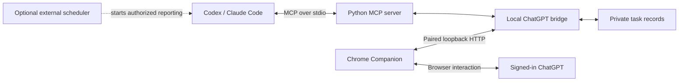

# WebContentAgent

**Let Codex and Claude Code work with ChatGPT: share project updates, get fresh
ideas, and keep a conversation you can return to for progress summaries.**

WebContentAgent connects your coding agent to ChatGPT in your signed-in Chrome
browser through MCP (Model Context Protocol). Send prompts or PDFs, retrieve
replies, and continue the same conversation without manually copying everything
between applications.

> [!NOTE]
> **AI-generated project:** this project's code was generated with **OpenAI Codex
> and Claude Code**, under human direction. It is a practical experiment, not a
> polished reference implementation for line-by-line study. Start with the guides
> below rather than trying to learn the project by reading every generated file.
> Review the permissions and test the behavior you depend on. Contributions and
> improvements are very welcome.

[Install](docs/getting-started.md) · [Usage & project updates](docs/workflows.md) ·
[Contribute](CONTRIBUTING.md) · [Privacy](docs/privacy.md) · [MIT license](LICENSE)

**Status:** Windows-first developer preview, currently in a private repository.
Access is required until it is made public. Codex has historical live-use
evidence. Claude Code setup is documented through standard MCP; a live
Claude Code round trip remains to be validated.

## Why use it?

Coding agents see the implementation details. You may prefer to discuss the
bigger picture in ChatGPT. This bridge helps keep those two conversations connected.

- **Keep ChatGPT informed.** Have Codex or Claude Code report completed work,
  tests, blockers and next steps. With a separately configured scheduler, these
  updates can happen periodically while your project develops.
- **Get another perspective.** Ask ChatGPT to challenge a design, suggest an
  experiment or identify a missing assumption, then bring its feedback back to
  the coding agent for evaluation.
- **Catch up quickly.** Open the saved ChatGPT conversation and ask what changed,
  which decisions were made and what still needs attention. You do not need to
  reconstruct progress from several coding-agent chats.
- **Review documents in context.** Send an approved PDF and follow up in the same
  conversation when the design or report changes.

ChatGPT only knows what you send it. Its summaries may be incomplete or wrong;
repository state and test results remain the evidence. Periodic reporting requires
your coding client or an external scheduler: **this bridge does not install a timer
or send updates on its own.**

## Architecture



The coding agent chooses the report; Python validates and records the request;
Chrome Companion sends it and retrieves the matching reply. ChatGPT supplies the
second opinion. The scheduler is optional and configured separately.

Tell your agent: **“Report our project progress to ChatGPT, ask for alternative
approaches, and save the conversation URL privately for future updates.”**

See [module communication and recovery](docs/design.md),
[workflow prompts](docs/workflows.md), or the
[architecture and debugging blog](https://feiyuchen-blog.pages.dev/blog/codex-talks-to-chatgpt-through-a-local-agent/#release-update).

## Quick start

You need **Windows, Git, uv, Chrome, a signed-in ChatGPT account, and an MCP-capable
coding client**. uv manages Python 3.12. The bridge needs neither LM Studio nor an
OpenAI API key; access to ChatGPT is through your existing account and its limits.

### 1. Install and pair

```powershell
git clone https://github.com/felixchenfy/WebContentAgent.git
cd WebContentAgent
uv sync --python 3.12 --frozen
uv run python -m web_content_agent.chatgpt_pairing
```

In Chrome, open `chrome://extensions`, enable **Developer mode**, choose
**Load unpacked**, and select this checkout's `chrome_extension` folder.
Open ChatGPT and sign in normally. Generated pairing files stay on your machine.

### 2. Connect your coding client

Register this local stdio MCP command, replacing the example with your absolute path:

```text
uv --directory C:/path/to/WebContentAgent run wca-mcp
```

Follow the client-specific instructions for [Codex](docs/getting-started.md#codex)
or [Claude Code](docs/getting-started.md#claude-code). They include timeouts and
configuration verification. No separate Node adapter repository is required.

### 3. Try a small question

```text
Use ask_chatgpt to ask: "Reply with BRIDGE_OK."
Set thinking_mode to "current". Return the reply and conversation URL.
```

A successful result returns the matching reply and a canonical conversation URL.
Tool discovery alone does not prove that sending and reading work. For PDF
uploads, first configure the [private upload allowlist](docs/getting-started.md#pdf-uploads).

## Other capabilities

| Capability | What it adds |
| --- | --- |
| Local-model web extraction | Use LM Studio to select and clean articles or traverse an in-scope course |
| Durable collection jobs | Checkpoints, resume, raw evidence, images, cleaned Markdown and validation |
| Browser workflow recovery | Durable submission records, duplicate-send protection and bounded read-only recovery |
| Optional supervised daily assistant | Separate model advice, supervisor approval, one-use submission and website verification |

These are optional. Start with the ChatGPT bridge. Collection additionally needs
LM Studio and Playwright Chromium; JavaScript development tests need Node.js.
The [installation guide](docs/getting-started.md) explains those paths separately.

## Reliability and privacy

The bridge runs locally, but chosen questions and PDFs are sent to ChatGPT.
Private task records and pairing tokens are excluded from Git. The extension has
powerful browser permissions; read [privacy and permissions](docs/privacy.md).

A timeout or failed confirmation is not proof that nothing was sent. Do not
blindly resend. Recovery must identify the original request and conversation.
Verified reply extraction is not a guarantee that the answer is correct.
Website changes, login expiry and usage limits can interrupt workflows.

This is an independent project, not an official OpenAI or Anthropic product.
See [troubleshooting](docs/getting-started.md#troubleshooting),
[security reporting](SECURITY.md) and [known limits](docs/roadmap.md).

## Contributions welcome

Bug reports, clearer documentation, synthetic regression fixtures, client setup
reports and focused pull requests are all welcome. You do not need to rewrite
the project to help. Good starting points include Claude Code validation, easier
onboarding and reproductions of changed browser layouts.

Read [CONTRIBUTING.md](CONTRIBUTING.md) for setup, checks and the PR workflow.
AI-assisted contributions are welcome; contributors remain responsible for
understanding and validating their changes. Please follow our
[community guidelines](CODE_OF_CONDUCT.md).

## Documentation

- [Installation and troubleshooting](docs/getting-started.md)
- [Project reports, second opinions and progress summaries](docs/workflows.md)
- [Architecture and boundaries](docs/design.md)
- [Roadmap and compatibility](docs/roadmap.md)
- [Release notes](docs/release-notes.md)
- Background: [bridge design](https://feiyuchen-blog.pages.dev/blog/codex-talks-to-chatgpt-through-a-local-agent/),
  [local extraction](https://feiyuchen-blog.pages.dev/blog/local-llm-web-agent/),
  [supervised browser tasks](https://feiyuchen-blog.pages.dev/blog/signed-in-chrome-daily-assistant/)

Maintained by [Feiyu Chen](https://github.com/felixchenfy). Licensed under [MIT](LICENSE).
Model weights, downloaded content and third-party services retain their own terms.
