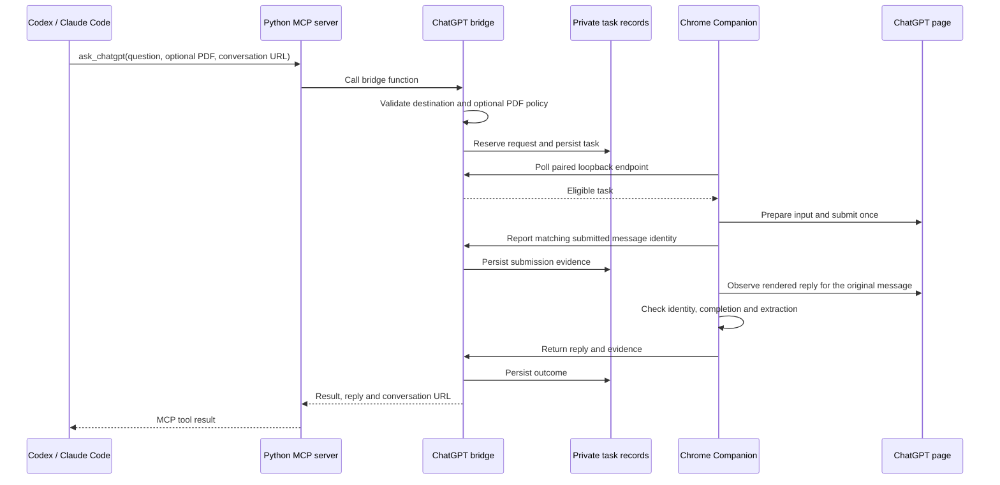
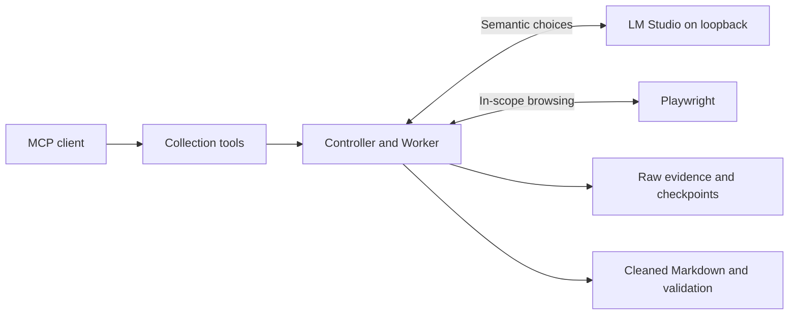

# Architecture and module communication

Python owns scope, traversal, file validation, retries, task state and persistence.
The local model owns semantic choices only in optional collection workflows. The ChatGPT route is a separate browser
workflow: it does not call LM Studio and does transmit authorized content remotely.

Collection discovers in-scope links, extracts source evidence, downloads assets,
and writes derived Markdown. Final raw content is immutable; cleanup writes to
cleaned output. Checkpoints and manifests let resumed runs validate completed
items before skipping them. Model requests have an explicit context budget.

MCP is a thin control interface. Tools do not provide arbitrary shell execution,
credential export or unrestricted file writes. PDF uploads enforce real paths,
allowed roots, file type and size. The Chrome bridge binds loopback and pairs
with the extension using a locally generated token.

Submission is a state transition with durable evidence. Ambiguous sends remain
protected against replay. Recovery reads are bound to the intended conversation
and message. Reply extraction and factual correctness are separate obligations.

The optional daily assistant records the exact question and ordered options,
awaits supervisor review, revalidates the page, and consumes a one-use permit.
An attempt or consumed permit does not establish daily completion. Verify the
website result before considering another run; never resubmit a graded question.

Do not bypass login, CAPTCHA, paywalls, DRM or site access restrictions.

## Follow one bridge request

This is the direct Python MCP route documented in the quickstart. The MCP server
and bridge run in the same Python process; the extension initiates HTTP polling.
The optional Node adapter described in the historical blog is a different entry point.

This diagram shows a successful exchange, not a guarantee of delivery. An
uncertain send remains protected against replay. Eligible extraction failures can
use a bounded read-only recovery tied to the original message; a new send is not
recovery. The reply's factual correctness still needs evaluation.

## Modules and responsibilities

| Module | Responsibility | Communication |
| --- | --- | --- |
| `src/web_content_agent/mcp/server.py` | Expose high-level tools | MCP stdio with the coding client; Python calls internally |
| `src/web_content_agent/chatgpt_chrome_bridge.py` | Validate requests, coordinate tasks and record outcomes | Paired loopback HTTP with Companion; private local state |
| `chrome_extension/` | Operate the signed-in page and collect matching evidence | Poll the bridge, interact with the page, post observations/results |
| Collection controller and Worker | Discover, extract, resume and validate optional collections | Playwright, local files and the LM Studio loopback endpoint |
| External scheduler, if configured | Decide when an authorized agent run starts | Client-specific; not a server-owned timer |

The ChatGPT route does not use LM Studio. The optional collection route is separate:

For the development story, see the
[bridge architecture and failure analysis](https://feiyuchen-blog.pages.dev/blog/codex-talks-to-chatgpt-through-a-local-agent/)
and [local extraction article](https://feiyuchen-blog.pages.dev/blog/local-llm-web-agent/).
The bridge overview adapts the blog's logical component diagram to the current
direct MCP entry point. Dated incidents in the article describe historical versions.
